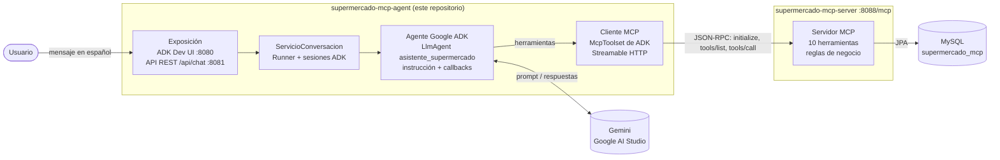
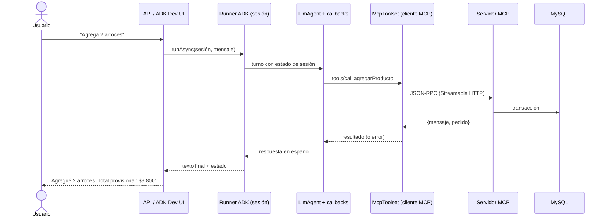

# Asistente de Supermercado — agente Google ADK + MCP

Laboratorio académico del curso de **Arquitectura de Software** — Universidad de Antioquia.

Chatbot en español que atiende **pedidos de supermercado a domicilio**. Está construido con
**Google Agent Development Kit (ADK) para Java** y se integra mediante **Model Context Protocol (MCP)**
con el servidor [`supermercado-mcp-server`](https://github.com/Camii1234/supermercado-mcp-server), que
publica las operaciones del negocio sobre MySQL. El agente no tiene lógica de negocio propia ni acceso a
la base de datos: todo dato del supermercado (productos, precios, existencias, pedidos, totales y estados)
lo obtiene de las herramientas MCP.

---

## 1. Contexto y objetivo

El laboratorio tiene dos etapas:

1. **Servidor MCP** (repositorio aparte): expone diez herramientas de negocio con reglas de stock y estados.
2. **Agente conversacional** (este repositorio): transforma el proyecto base del profesor
   ([diegobotia/agentemcp](https://github.com/diegobotia/agentemcp)) en un asistente que:

- saluda y explica sus capacidades;
- muestra el catálogo, busca productos por nombre, categoría o SKU y consulta existencias;
- recopila nombre, teléfono y dirección y crea el pedido solo cuando el cliente quiere comprar;
- agrega productos (incrementando cantidades), los retira y resume el pedido con cantidades, precios
  unitarios, subtotales y total;
- **confirma solo con autorización explícita** después de mostrar el resumen, y cancela solo con una
  intención clara;
- consulta o lista pedidos;
- explica en lenguaje sencillo los errores (producto inexistente, stock insuficiente, pedido inexistente,
  estado no permitido, servidor no disponible);
- conserva en la sesión el identificador del pedido en curso.

## 2. Arquitectura

### 2.1 Proyecto base encontrado

| Elemento | Proyecto base |
|----------|---------------|
| Tecnologías | Java 21, Spring Boot 3.5.16, Maven Wrapper, Google ADK (`google-adk` 0.6.0 + `google-adk-dev` 1.0.0) |
| Agente | Una clase con `public static BaseAgent ROOT_AGENT` (`LlmAgent` + `McpToolset` Streamable HTTP) |
| Interfaz | ADK Dev UI (`com.google.adk.web.AdkWebServer`) mediante `exec:java@runAdkWebServer` en el puerto 8080 |
| Spring Boot | Aplicación sin endpoints propios; solo la prueba `contextLoads` |

### 2.2 Arquitectura final

Se conservan la tecnología y las dos formas de ejecución del proyecto base (ADK Dev UI y aplicación
Spring Boot). La responsabilidad se separa en capas:



Secuencia simplificada de un turno:



### 2.3 Paquetes

| Paquete | Responsabilidad | Clases principales |
|---------|-----------------|--------------------|
| `config` | Configuración centralizada desde variables de entorno y ensamblaje Spring | `ConfiguracionAgente`, `AgenteSupermercadoConfig`, `VerificacionInicial` |
| `mcp` | Integración MCP: conexión, contrato de nombres, diagnóstico, clasificación de fallos y adaptador de transporte | `ConexionMcpSupermercado`, `HerramientasSupermercado`, `DiagnosticoMcp`, `ClasificadorFallosMcp`, `TransporteMcpConNotificacionesAcotadas` |
| `agente` | Definición del agente ADK, instrucción y callbacks de control | `FabricaAsistenteSupermercado`, `InstruccionesAgente`, `GuardiaOperacionesCriticas`, `PoliticaAutorizacion`, `RegistroContextoPedido`, `ManejadorErroresHerramientas` |
| `conversacion` | Caso de uso conversar: validación, sesiones, ejecución y traducción de errores | `ServicioConversacion`, `RespuestaConversacion`, `FalloConversacionException` |
| `web` | Exposición HTTP y errores JSON | `ChatController`, `ManejadorErroresWeb` |
| raíz | Arranque Spring y `ROOT_AGENT` para la ADK Dev UI | `AgenteMcpApplication`, `AsistenteSupermercadoAgent` |

La instrucción de sistema está en `src/main/resources/agente/instrucciones-asistente.txt` (UTF-8).

## 3. Tecnologías

| Tecnología | Versión | Uso |
|------------|---------|-----|
| Java | 21 | Lenguaje |
| Spring Boot | 3.5.16 | Aplicación, API REST, inyección de dependencias |
| Google ADK (`google-adk`, `google-adk-dev`) | 1.0.0 | Agente, runner, sesiones, `McpToolset`, Dev UI |
| SDK Java de MCP | 0.17.2 (transitivo de ADK) | Cliente MCP Streamable HTTP |
| Google GenAI | 1.44.0 (transitivo de ADK) | Acceso a Gemini |
| RxJava 3 | 3.1.12 (gestionado por Spring Boot) | Flujos de ADK |
| JUnit 5, AssertJ, Mockito, MockMvc | gestionados por Spring Boot | Pruebas |
| Maven Wrapper | Maven 3.9.16 | Construcción |

**Cambio de versiones respecto al proyecto base (justificado).** El `pom.xml` original declaraba
`google-adk` 0.6.0 y `google-adk-dev` 1.0.0. Este último depende de `google-adk` 1.0.0, pero Maven
resolvía 0.6.0: la Dev UI 1.0.0 corría sobre un núcleo 0.6.0 que usa el SDK MCP 0.14.0. Se alinearon
ambas en **1.0.0** (núcleo con SDK MCP 0.17.2, la misma familia que usa el servidor). Además, se quitó la
versión fija de `rxjava` (3.1.8, que rebajaba la 3.1.12 que pide ADK 1.0.0) y la dependencia directa
`httpclient5` 5.4.2, que el código no usa: llega de forma transitiva con la versión que gestiona Spring Boot.
Se verificó que compilan las pruebas, el empaquetado, la API y la ADK Dev UI.

## 4. Requisitos previos

- JDK 21 (`java -version`).
- MySQL 8 con la base `supermercado_mcp` creada por el servidor MCP.
- El servidor MCP [`supermercado-mcp-server`](https://github.com/Camii1234/supermercado-mcp-server)
  (rama `feature/supermercado-mcp`) en ejecución en `http://localhost:8088/mcp`.
- Una clave de API de **Google AI Studio** para Gemini (solo para conversar; las pruebas no la necesitan).
- No se necesita instalar Maven: se usa `mvnw.cmd`.

## 5. Variables de entorno

| Variable | Obligatoria | Predeterminado | Descripción |
|----------|-------------|----------------|-------------|
| `GOOGLE_API_KEY` | Sí, para conversar | — | Clave de Google AI Studio. La lee la librería de Gemini; el proyecto nunca la registra ni la devuelve. |
| `GEMINI_MODEL` | No | `gemini-3.6-flash` | Modelo Gemini (el validado en la prueba conversacional real, §7.1). |
| `MCP_SERVER_URL` | No | `http://localhost:8088/mcp` | Endpoint Streamable HTTP del servidor MCP. |
| `MCP_CONNECT_TIMEOUT_SECONDS` | No | `10` | Conexión e inicialización de la sesión MCP. |
| `MCP_READ_TIMEOUT_SECONDS` | No | `30` | Tiempo máximo de cada petición MCP (`tools/list`, `tools/call`). |
| `MCP_NOTIFICATION_TIMEOUT_SECONDS` | No | `2` | Espera máxima de notificaciones MCP y del cierre de sesión (ver §12). |
| `MCP_VERIFY_ON_STARTUP` | No | `true` | La API comprueba al arrancar que el servidor publique las 10 herramientas. |
| `AGENT_RESPONSE_TIMEOUT_SECONDS` | No | `120` | Tiempo máximo de un turno completo del agente. |
| `AGENT_PORT` | No | `8081` | Puerto de la API REST. |

Alternativas de credenciales de la librería de Gemini: `GEMINI_API_KEY` en lugar de `GOOGLE_API_KEY`, o
Vertex AI con `GOOGLE_GENAI_USE_VERTEXAI=true`, `GOOGLE_CLOUD_PROJECT` y `GOOGLE_CLOUD_LOCATION` más
credenciales de Google Cloud. Vertex AI es opcional; el laboratorio usa Google AI Studio.

`.env.example` lista todas las variables con valores de ejemplo. `.env` está en `.gitignore`.

### 5.1 Configurar la clave de Google sin exponerla

1. Crea una clave en <https://aistudio.google.com/apikey>.
2. Defínela **solo en tu sesión de PowerShell**, sin escribirla en archivos versionados. `Read-Host -AsSecureString`
   evita que quede en el historial ni en pantalla:

   ```powershell
   $clave = Read-Host "GOOGLE_API_KEY" -AsSecureString
   $env:GOOGLE_API_KEY = [Runtime.InteropServices.Marshal]::PtrToStringAuto(
       [Runtime.InteropServices.Marshal]::SecureStringToBSTR($clave))
   ```

3. También puedes copiar `.env.example` a `.env` (ignorado por Git), poner allí tu clave y cargarlo en la sesión:

   ```powershell
   Get-Content .env | Where-Object { $_ -match '^\s*[A-Z_]+=' } | ForEach-Object {
       $nombre, $valor = $_ -split '=', 2
       Set-Item -Path "Env:$($nombre.Trim())" -Value $valor.Trim()
   }
   ```

Nunca publiques la clave en capturas, issues ni commits. Si se expone, revócala en Google AI Studio.

## 6. Puesta en marcha

### 6.1 Iniciar MySQL

Inicia el servicio de MySQL 8 (por ejemplo, desde *Servicios* de Windows o con `net start MySQL80` en una
consola de administrador). La primera vez, crea la base con el script del servidor:

```powershell
cd ..\supermercado-mcp-server
mysql -u root -p -e "source src/main/resources/schema.sql"
```

### 6.2 Iniciar primero el servidor MCP

```powershell
cd ..\supermercado-mcp-server
$env:PWD_UDEA = "<contraseña de MySQL>"   # solo en la sesión actual
.\mvnw.cmd spring-boot:run
```

Espera el mensaje `Started SupermercadoMcpApplication`. El endpoint queda en `http://localhost:8088/mcp`.

### 6.3 Iniciar después el agente

Opción A — **ADK Dev UI** (interfaz gráfica de Google ADK, la forma prevista por el proyecto base):

```powershell
cd ..\supermercado-mcp-agent
# GOOGLE_API_KEY definida como en §5.1
.\mvnw.cmd clean compile exec:java@runAdkWebServer
```

Abre <http://localhost:8080>, elige `asistente_supermercado` y conversa. La pestaña de estado de la sesión
muestra `pedido_actual_id` y `pedido_actual_estado`. Se usa `clean` para que ADK no intente cargar las
clases de prueba de `target/test-classes` (si existen, solo produce avisos en el log).

Opción B — **API REST** (aplicación Spring Boot):

```powershell
.\mvnw.cmd spring-boot:run
# o bien, después de empaquetar:
java -jar target\supermercado-mcp-agent-0.0.1-SNAPSHOT.jar
```

Al arrancar, el log informa si hay credenciales de Gemini y si el servidor MCP respondió con las 10 herramientas.

```powershell
# Estado del asistente y del servidor MCP
Invoke-RestMethod http://localhost:8081/api/estado

# Conversación: el primer mensaje crea la sesión; reenvía el sesionId en los siguientes
$r = Invoke-RestMethod -Method Post http://localhost:8081/api/chat -ContentType "application/json; charset=utf-8" `
     -Body ([Text.Encoding]::UTF8.GetBytes('{"mensaje":"Hola, ¿qué productos tienen?"}'))
$r.respuesta
$cuerpo = @{ sesionId = $r.sesionId; mensaje = "Busca arroz" } | ConvertTo-Json
Invoke-RestMethod -Method Post http://localhost:8081/api/chat -ContentType "application/json; charset=utf-8" `
     -Body ([Text.Encoding]::UTF8.GetBytes($cuerpo))
```

Contrato de la API:

| Método y ruta | Cuerpo | Respuesta |
|---------------|--------|-----------|
| `POST /api/chat` | `{"sesionId": "opcional", "mensaje": "texto"}` | `200 {"sesionId", "respuesta", "pedidoActualId"}` |
| `GET /api/estado` | — | `200 {"agente", "modelo", "credencialesGemini", "mcp": {...}}` |

Errores: `400 SOLICITUD_INVALIDA`, `503 MCP_NO_DISPONIBLE` / `MODELO_NO_DISPONIBLE`,
`504 MCP_TIEMPO_AGOTADO` / `TIEMPO_AGOTADO`, `502 MCP_ERROR_PROTOCOLO`, `500 INTERNO`, siempre con
`{"codigo", "mensaje", "sesionId"}` y sin trazas.

## 7. Pruebas y empaquetado

```powershell
.\mvnw.cmd clean test
.\mvnw.cmd clean package
```

Si el wrapper falla con `PKIX path building failed` (certificados en Windows), úsalo solo en la sesión actual:

```powershell
$env:MAVEN_OPTS = "-Djavax.net.ssl.trustStoreType=Windows-ROOT"
```

Las pruebas **no usan Gemini ni API key, ni necesitan el servidor MCP**. Emplean dos dobles de prueba:
`ModeloGuionado` (un `BaseLlm` que sigue un guion) y `ServidorMcpFalso` (un servidor MCP en memoria
conectado por el punto de extensión `McpTransportBuilder` de ADK). Así se ejercitan el `McpToolset`,
el `Runner`, las sesiones y los callbacks reales de ADK.

| Clase de prueba | Qué valida |
|-----------------|------------|
| `AgenteMcpApplicationTests` | Carga del contexto sin servidor ni API key; la URL MCP se toma de la configuración |
| `ConfiguracionAgenteTest` | Predeterminados, `MCP_SERVER_URL`, validación de URL y tiempos, detección de credenciales sin exponerlas |
| `FabricaAsistenteSupermercadoTest` | Nombre, modelo, toolset MCP, callbacks, reglas clave de la instrucción, `ROOT_AGENT` para la Dev UI |
| `ConexionMcpSupermercadoTest` | Descubrimiento de las 10 herramientas con ADK, filtrado, diagnóstico y servidor no disponible |
| `TransporteMcpConNotificacionesAcotadasTest` | Notificaciones acotadas, peticiones intactas y cierre sin bloqueo |
| `ClasificadorFallosMcpTest` | Servidor no disponible, tiempo agotado, error de protocolo y mensajes sin detalles técnicos |
| `PoliticaAutorizacionTest` | Confirmaciones y cancelaciones explícitas frente a ambiguas, dudosas o negativas |
| `ServicioConversacionTest` | Respuesta exitosa, error de herramienta, conservación del pedido en la sesión, aislamiento entre sesiones, confirmación solo con resumen previo y autorización explícita, cancelación con intención clara, MCP o modelo no disponibles y validación de entrada |
| `ChatControllerTest` | JSON UTF-8, códigos HTTP 400/503/504 y estado |
| `CalidadRepositorioTest` | UTF-8 de todos los archivos de texto, ausencia de secretos, `.env` ignorado y sin restos del dominio anterior |

**Prueba de integración contra el servidor real** (opcional, no se ejecuta con `clean test`):

```powershell
$env:MCP_INTEGRATION = "true"          # lecturas: herramientas, catálogo, búsqueda, stock, errores
$env:MCP_INTEGRATION_WRITE = "true"    # además: pedidos de demostración que se cancelan al final
.\mvnw.cmd test "-Dtest=ServidorMcpRealIT" "-Dsurefire.failIfNoSpecifiedTests=false"
```

Las pruebas de escritura crean pedidos a nombre de `Cliente Demo Laboratorio ADK` (teléfono `300 000 0000`,
dirección `Calle Demo 1 # 2-3`). Todos terminan en `CANCELADO`: uno que se cancela en borrador y otro que
se confirma (descuenta stock) y luego se cancela (restituye el stock exacto). No se tocan otros pedidos.

### 7.1 Validación conversacional real con Gemini

Se validó una conversación completa en la **ADK Dev UI** con `GEMINI_MODEL=gemini-3.6-flash`, el servidor MCP
real y MySQL (la clave se definió solo en la sesión de PowerShell y no se registra en ningún archivo):

| Paso | Resultado observado |
|------|---------------------|
| Saludo inicial | El asistente se presentó y explicó sus capacidades. |
| Catálogo | `listarProductos` devolvió 11 productos. |
| Creación del pedido | Se creó el pedido 8 en estado `BORRADOR`. |
| Productos | Se agregaron 2 arroces y 3 leches; total $22.400. |
| Resumen | Se consultó y mostró el resumen antes de confirmar. |
| Confirmación explícita | El pedido 8 pasó a `CONFIRMADO`. |
| Cancelación explícita | El pedido 8 pasó a `CANCELADO`. |
| Inventario | Se restauró el stock: arroz 120 y leche 80. |

## 8. Ejemplos de conversación

> **Cliente:** Hola\
> **Asistente:** ¡Hola! Soy el Asistente de Supermercado. Puedo mostrarte el catálogo, buscar productos,
> consultar existencias y armar tu pedido a domicilio. ¿Qué necesitas?

> **Cliente:** ¿Tienen arroz? *(→ `buscarProductos`)*\
> **Asistente:** Sí: Arroz blanco 1 kg (Granos) a $4.900, con 120 unidades disponibles.

> **Cliente:** Quiero pedir 2. *(faltan datos: el asistente no crea el pedido todavía)*\
> **Asistente:** ¡Claro! Para crear tu pedido necesito tu nombre completo, teléfono y dirección de entrega.

> **Cliente:** Ana Gómez, 300 000 0000, Calle 1 # 2-3. *(→ `crearPedido`, `agregarProducto`)*\
> **Asistente:** Creé tu pedido N.º 42 y agregué 2 × Arroz blanco 1 kg. Total provisional: $9.800.

> **Cliente:** Eso es todo. *(→ `consultarPedido`)*\
> **Asistente:** Resumen del pedido 42 (BORRADOR) para Ana Gómez, Calle 1 # 2-3: 2 × Arroz blanco 1 kg a
> $4.900 = $9.800. Total: $9.800. ¿Confirmas el pedido por $9.800?

> **Cliente:** ok *(ambiguo: la guardia bloquea `confirmarPedido`)*\
> **Asistente:** Para confirmar necesito una respuesta explícita. ¿Confirmas el pedido por $9.800?

> **Cliente:** Sí, confirmo. *(→ `confirmarPedido`)*\
> **Asistente:** ¡Listo! El pedido 42 quedó CONFIRMADO por un total de $9.800.

Este diálogo es un ejemplo ilustrativo e independiente: el pedido 42 y el total de $9.800 son ficticios y no
corresponden a la prueba real. En uso real, Gemini redacta las respuestas a partir de los datos que devuelven
las herramientas. La conversación real validada (pedido 8 por $22.400) se resume en §7.1.

## 9. Herramientas MCP disponibles

Las publica el servidor y el agente las descubre con `tools/list`; el agente solo expone al modelo estas diez.

| # | Herramienta | Argumentos | Uso en la conversación |
|---|-------------|-----------|------------------------|
| 1 | `listarProductos` | — | Catálogo a la venta (disponibles con stock), por categoría y nombre |
| 2 | `buscarProductos` | `texto` | Búsqueda por nombre, categoría o SKU |
| 3 | `consultarStock` | `productoId` | Existencias y si el producto puede venderse |
| 4 | `crearPedido` | `clienteNombre`, `telefono`, `direccion` | Crea un pedido `BORRADOR` |
| 5 | `agregarProducto` | `pedidoId`, `productoId`, `cantidad` | Agrega unidades o incrementa la cantidad; recalcula el total |
| 6 | `retirarProducto` | `pedidoId`, `productoId` | Retira la línea completa |
| 7 | `consultarPedido` | `pedidoId` | Resumen con líneas, subtotales y total |
| 8 | `confirmarPedido` | `pedidoId` | Revalida y descuenta stock; pasa a `CONFIRMADO` |
| 9 | `listarPedidos` | — | Todos los pedidos con estado y total |
| 10 | `cancelarPedido` | `pedidoId` | Cancela; si estaba confirmado, restituye el stock |

## 10. Manejo de sesiones y del pedido en curso

- **ADK Dev UI**: cada conversación es una sesión de ADK (`InMemorySessionService` de la Dev UI).
- **API REST**: `ServicioConversacion` usa un `InMemoryRunner`. El primer mensaje sin `sesionId` crea una
  sesión con un UUID, que se devuelve y se reenvía en los mensajes siguientes. Los turnos de una misma
  sesión se procesan en orden.
- El callback `RegistroContextoPedido` guarda en el estado de la sesión, **solo a partir de respuestas
  exitosas del servidor**:
  - `pedido_actual_id` y `pedido_actual_estado` (al crear, consultar, confirmar o cancelar);
  - `resumen_pedido_id` y `resumen_invocacion_id`, el último resumen que vio el cliente. Se borran cuando
    el pedido cambia (agregar o retirar).
- La instrucción del agente incluye `{pedido_actual_id?}` y `{pedido_actual_estado?}`, que ADK reemplaza
  en cada turno, de modo que el modelo recuerda el pedido sin inventar el número.
- Las sesiones viven en memoria: se pierden al reiniciar el agente. Los pedidos persisten en MySQL y pueden
  consultarse por número.

## 11. Confirmaciones y control de operaciones irreversibles

Además de la instrucción de sistema, el callback `GuardiaOperacionesCriticas` (antes de cada herramienta)
lo hace cumplir de forma **determinística**:

- `confirmarPedido` solo se ejecuta si:
  1. el resumen de **ese** pedido se consultó con `consultarPedido`,
  2. en un turno **anterior** (el cliente lo vio),
  3. sin cambios posteriores, y
  4. el mensaje actual del cliente es una confirmación explícita según `PoliticaAutorizacion`.
- `cancelarPedido` solo se ejecuta si el mensaje actual expresa claramente la intención de cancelar o
  responde afirmativamente.
- `PoliticaAutorizacion` es conservadora:
  - Rechaza expresiones ambiguas ("ok", "dale", "listo", "bueno"), dudas ("creo que sí", "todavía",
    "tal vez", "después") y negaciones ("no lo confirmes").
  - Acepta, por ejemplo, "Sí, confirmo", "Confirma el pedido", "Cancela el pedido 7".

Si la guardia bloquea una operación, la herramienta **no** se invoca y el modelo recibe
"Operación NO ejecutada por la política del asistente: …" para que pida la confirmación que falta.
La guardia no repite reglas de negocio: estados, stock y totales los valida el servidor.

## 12. Manejo de errores

| Situación | Comportamiento |
|-----------|----------------|
| Error de negocio del servidor (`isError: true`) | ADK lo entrega al modelo como `{"error": "... Details: <mensaje del servidor>"}`; el asistente lo explica (p. ej. stock insuficiente) y propone el siguiente paso. |
| Excepción técnica al ejecutar una herramienta | `ManejadorErroresHerramientas` la convierte en un error claro, sin trazas, e indica que el resultado no está verificado. |
| Servidor MCP no disponible | El turno falla con `MCP_NO_DISPONIBLE` (HTTP 503) y un mensaje para el usuario; la API arranca igual y lo informa en el log. |
| Tiempo agotado (MCP o turno completo) | `MCP_TIEMPO_AGOTADO` / `TIEMPO_AGOTADO` (HTTP 504); se recomienda consultar el pedido antes de repetir. |
| Error de protocolo MCP | `MCP_ERROR_PROTOCOLO` (HTTP 502). |
| Sin clave o clave rechazada por Gemini | `MODELO_NO_DISPONIBLE` (HTTP 503). |
| Entrada inválida (mensaje vacío, mayor de 2000 caracteres, `sesionId` con caracteres no permitidos, JSON mal formado) | HTTP 400 `SOLICITUD_INVALIDA`. |

**Adaptador de transporte MCP (`TransporteMcpConNotificacionesAcotadas`).** En este entorno se observó que la
respuesta `202 Accepted` del servidor a la notificación `notifications/initialized` llega con
`transfer-encoding: chunked` y nunca recibe el fragmento final. Con HTTP/1.1 la conexión queda abierta unos
60 s hasta cortarse; con HTTP/1.0 responde de inmediato.

El transporte del SDK MCP espera a que termine ese cuerpo vacío, así que el `initialize` de ADK se
bloqueaba y no podía descubrir las herramientas: con el proyecto base fallaba por tiempo agotado a los 30 s.

El adaptador implementa el punto de extensión `McpTransportBuilder` de ADK y envuelve el transporte
estándar. Hace dos cosas:
- **Notificaciones** (que en JSON-RPC no tienen respuesta): espera como máximo
  `MCP_NOTIFICATION_TIMEOUT_SECONDS` y luego las da por enviadas.
- **Cierre de sesión**: lo acota con el mismo tiempo.

Las peticiones (`tools/list`, `tools/call`) no se modifican: si el servidor no hubiera procesado la
notificación, la petición siguiente fallaría con un error explícito. No se usan llamadas HTTP propias:
la sesión MCP, el `Mcp-Session-Id` y el protocolo los gestionan el SDK y ADK.

## 13. Seguridad

- Ningún secreto se versiona: `GOOGLE_API_KEY` se lee del entorno, `.env` está en `.gitignore` y
  `.env.example` solo contiene valores de ejemplo. `CalidadRepositorioTest` busca patrones de claves
  (Google, OAuth, GitHub, claves privadas) en los archivos del proyecto.
- El log nunca muestra la clave: solo indica si hay credenciales. Tampoco registra nombres, teléfonos ni
  direcciones de clientes; solo ids de pedido, nombres de herramientas y categorías de error.
- El agente solo expone al modelo las diez herramientas del contrato (filtro del `McpToolset`), aunque el
  servidor publique otras.
- Las operaciones irreversibles requieren autorización explícita verificada en código (§11).
- Los errores que ve el usuario no incluyen trazas ni detalles internos.
- La API no tiene autenticación: está pensada para `localhost` durante el laboratorio.

## 14. Limitaciones conocidas

- Conversar requiere una `GOOGLE_API_KEY` válida; sin ella, el asistente responde `MODELO_NO_DISPONIBLE`.
  La conversación real se validó con `gemini-3.6-flash` (§7.1); con otros modelos el comportamiento puede
  variar. La calidad de las respuestas depende del modelo: la guardia impide
  confirmar o cancelar sin autorización, pero no puede garantizar la redacción.
- Las sesiones son en memoria (ADK `InMemoryRunner` / Dev UI) y no hay expiración de sesiones en la API.
- `McpTool` de ADK reintenta hasta 3 veces una llamada que falla por error técnico (no por `isError`).
  Si una escritura agotara el tiempo después de llegar al servidor, un reintento podría repetirla. Por eso
  el asistente pide consultar el pedido cuando el resultado no se pudo verificar.
- `PoliticaAutorizacion` es heurística y conservadora: puede pedir una confirmación adicional ante frases
  válidas poco comunes, pero no autoriza expresiones ambiguas.
- `retirarProducto` elimina la línea completa (regla del servidor); para reducir unidades hay que retirar y
  volver a agregar.
- La ADK Dev UI 1.0.0 se publica para Spring Boot 4, pero aquí se ejecuta con el Spring Boot 3.5.16 del
  proyecto base. Se verificó que arranca, lista `asistente_supermercado` y crea sesiones; no se probó cada
  función de la interfaz.

## 15. Solución de problemas

| Síntoma | Causa probable y solución |
|---------|---------------------------|
| `PKIX path building failed` al ejecutar `mvnw.cmd` | `$env:MAVEN_OPTS = "-Djavax.net.ssl.trustStoreType=Windows-ROOT"` en la sesión actual. |
| `/api/estado` muestra `"disponible": false` con `SERVIDOR_NO_DISPONIBLE` | El servidor MCP no está en marcha o `MCP_SERVER_URL` es incorrecta. Inicia primero MySQL y el servidor (§6). |
| `MODELO_NO_DISPONIBLE` | Falta `GOOGLE_API_KEY` en la misma sesión de PowerShell que ejecuta el agente, o la clave/modelo no es válido. |
| La Dev UI no muestra `asistente_supermercado` | Ejecuta `.\mvnw.cmd clean compile exec:java@runAdkWebServer` desde la raíz del proyecto. |
| Avisos `Class definition error loading ...Test` en la Dev UI | ADK escanea `target/test-classes`; usa `clean compile` antes de `exec:java`. |
| El agente tarda unos segundos en el primer mensaje | Se inicializa la sesión MCP; si la `202` del servidor no termina, se espera `MCP_NOTIFICATION_TIMEOUT_SECONDS` (§12). |
| Inicialización MCP lenta o bloqueada en otros clientes MCP | Ver §12. El README del servidor también menciona la inspección HTTP de antivirus; excluir `localhost:8088` de esa inspección es una alternativa. |
| Puerto 8080 u 8081 ocupado | Cambia `--server.port` en el `pom.xml` (Dev UI) o `AGENT_PORT` (API). |
| Tildes mal mostradas en la consola | Es la codificación de la consola de Windows; las respuestas HTTP son UTF-8. Usa `chcp 65001` o Windows Terminal. |

## 16. Atribución

- Proyecto base del profesor: [diegobotia/agentemcp](https://github.com/diegobotia/agentemcp). Se
  conservaron Spring Boot, Google ADK, el patrón `ROOT_AGENT` con `McpToolset` Streamable HTTP y la
  ejecución de la ADK Dev UI con `exec:java@runAdkWebServer`. El agente de ejemplo de gestión de tareas
  del proyecto base se reemplazó por completo por el Asistente de Supermercado.
- Servidor MCP del laboratorio: [Camii1234/supermercado-mcp-server](https://github.com/Camii1234/supermercado-mcp-server).

## 17. Autoría

**Maria Camila Castañeda Piedrahita** — Arquitectura de Software, Universidad de Antioquia.
